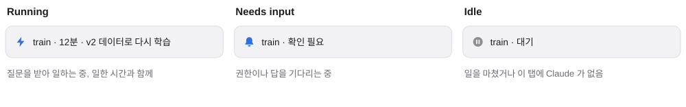
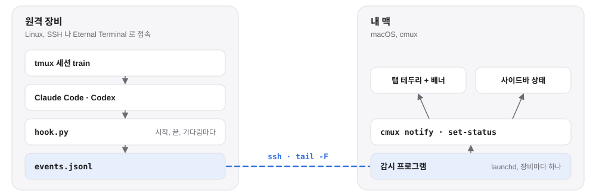

<h1 align="center">cmux-remote-notify</h1>

<p align="center"><b>원격 장비의 Claude Code·Codex 를 cmux 사이드바에서 바로.</b></p>

<p align="center">
  <a href="https://github.com/zoo3323/cmux-remote-notify/actions/workflows/test.yml"></a>
  <a href="LICENSE"></a>
  <br>
  <a href="README.md">English</a> · 한국어
</p>

<picture>
  <source media="(prefers-color-scheme: dark)" srcset="docs/img/hero-dark.ko.svg">
  
</picture>

다른 탭에서 하던 일을 계속하세요. 원격 서버(SSH 나 [Eternal Terminal](https://eternalterminal.dev/) 로 붙은 tmux)의 에이전트가 일을 끝내거나 확인을 기다리면 [cmux](https://cmux.com) 가 알려 줍니다. 맥 배너가 뜨고, 그 작업 공간에 읽지 않은 배지와 탭 테두리가 붙고, 사이드바에 세션마다 지금 하는 일이 보입니다. 이 도구가 없으면 cmux 는 원격 에이전트를 알아채지 못합니다.

## 설치

```bash
git clone https://github.com/zoo3323/cmux-remote-notify.git
cd cmux-remote-notify
bin/cmux-remote-notify install gpu-box     # ssh 로 붙는 이름
cmux-remote-notify test gpu-box            # 그 탭에 시험 알림
```

`install` 은 장비마다 한 번입니다. 장비에는 훅을, 맥에는 로그인할 때 켜지고 잠자기 뒤 스스로 다시 붙는 감시 프로그램을 넣습니다.

| 어디 | 필요한 것 |
|---|---|
| 맥 | cmux, `jq`(macOS 15 기본 포함, 또는 `brew install jq`), 비밀번호 없이 장비에 붙는 SSH 키 |
| cmux | 설정 › 자동화 › 소켓 제어 모드: **자동화 모드** |
| 장비 | Linux, `python3`, **tmux** 안에서 도는 Claude Code. Codex 도 됩니다(알림만) |

## 사이드바

<picture>
  <source media="(prefers-color-scheme: dark)" srcset="docs/img/states-dark.ko.svg">
  
</picture>

tmux 세션마다 한 줄이 그 탭이 있는 작업 공간에 붙습니다. 작업 공간 설명 줄에는 장비 이름이 보이고, `install gpu-box --label GPU` 로 하면 `GPU` 로 보입니다.

## 동작

<picture>
  <source media="(prefers-color-scheme: dark)" srcset="docs/img/flow-dark.ko.svg">
  
</picture>

훅은 파일에 한 줄을 덧붙이고 끝나서 에이전트를 느리게 하지 않고, 포트도 열지 않습니다. 맥은 장비마다 SSH 연결 하나만 둡니다. 탭은 그 안에서 도는 `ssh`·`et` 명령으로 찾습니다.

```bash
ssh -t gpu-box tmux new -A -s train
et gpu-box -c "tmux attach -t train"
ssh gpu-box        # 붙은 뒤 tmux 를 직접 켜도 됨: 그 장비로 열린 탭이 하나일 때
```

## 명령

| 명령 | |
|---|---|
| `install <장비> [--label 이름]` | 훅을 넣고 감시를 켭니다 (여러 번 해도 안전) |
| `test <장비> [세션]` | 시험 알림 한 번 |
| `status` | 감시 상태와 최근 기록 |
| `doctor [장비]` | 전부 점검하고 문제마다 고치는 법을 보여 줍니다 |
| `label <장비> [이름]` | 사이드바에 보일 장비 이름 |
| `uninstall <장비>` | 훅과 감시를 뺍니다 |

<details>
<summary><b>문제가 생기면</b></summary>

먼저 `cmux-remote-notify doctor` 를 돌립니다. 감시 프로그램, cmux 소켓 모드, SSH, 원격 훅, 열린 탭을 보고 문제마다 고치는 법을 적어 줍니다.

| 증상 | 흔한 원인 | 할 일 |
|---|---|---|
| 아무것도 안 옴 | 감시가 멈춤, 훅이 빠짐 | `install <장비>` 다시 |
| `test` 는 되는데 실제 작업은 안 옴 | 다른 도구가 장비의 `~/.claude/settings.json` 을 다시 씀 | `install <장비>` 다시 |
| 배너만 오고 탭 표시가 없음 | 그 세션이 열린 탭이 없음 | 위 명령 중 하나로 세션을 엶 |
| cmux 업데이트 뒤 멈춤 | 소켓 제어 모드가 'cmux 프로세스만' 으로 돌아감 | 자동화 모드로 |
| Esc 로 끊었는데 Running 이 남음 | Esc 는 `Stop` 을 보내지 않음 | 1분쯤 뒤 Idle 로 바뀜 |

기록: 맥 `~/Library/Logs/cmux-remote-notify/<장비>.log`, 장비 `~/.local/state/cmux-remote-notify/events.jsonl`

</details>

<details>
<summary><b>설치하면 바뀌는 것</b></summary>

| 어디 | 무엇 |
|---|---|
| 장비 | `~/.local/share/cmux-remote-notify/hook.py`, 이벤트 기록 `~/.local/state/cmux-remote-notify/` |
| 장비 | `~/.claude/settings.json` 의 훅 이벤트 7개에 하나씩, `~/.codex/config.toml` 의 `notify`(이미 있으면 그대로). 두 파일은 먼저 백업하고, `uninstall` 은 이 항목만 걷어 냅니다 |
| 맥 | 실행본 `~/.local/share/cmux-remote-notify/`(launchd 는 `~/Desktop` 을 못 읽음), 링크 `~/.local/bin/cmux-remote-notify`, `~/Library/LaunchAgents/io.github.zoo3323.cmux-remote-notify.<장비>.plist` |

</details>

<details>
<summary><b>더 자세히</b></summary>

안내 문구와 사이드바 글자는 macOS 언어를 따릅니다(영어, 한국어). `CMUX_REMOTE_NOTIFY_LANG=en` 이면 영어로 고정합니다.

Claude Code 백그라운드 세션(`/bg`)은 tmux 밖에서 돌기 때문에, 그 세션을 보고 있는 Claude 클라이언트의 탭에 상태를 붙입니다.

맥이 잠들었다 깨면 1분 남짓에 다시 붙고, 그 사이 생긴 이벤트도 받습니다(10분 넘은 것은 배너 없이 탭 표시만). 장비는 1분마다 하트비트를 보내서 끊긴 연결이 오래 남지 않습니다.

시험은 cmux·장비 없이 돕니다: `bash tests/run.sh`. 그림은 `python3 tools/make-images.py` 로 그립니다.

</details>

## 라이선스

[MIT](LICENSE)
