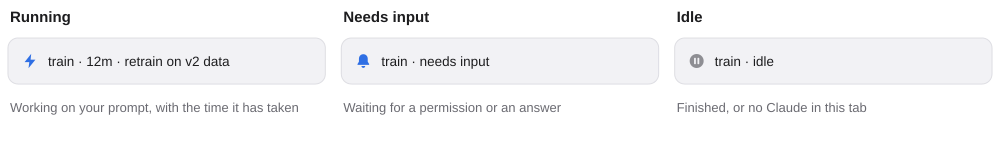
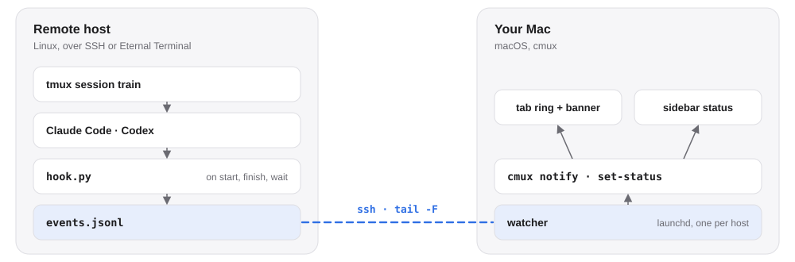

<h1 align="center">cmux-remote-notify</h1>

<p align="center"><b>Remote Claude Code and Codex, right in the cmux sidebar.</b></p>

<p align="center">
  <a href="https://github.com/zoo3323/cmux-remote-notify/actions/workflows/test.yml"></a>
  <a href="LICENSE"></a>
  <br>
  English · <a href="README.ko.md">한국어</a>
</p>

<picture>
  <source media="(prefers-color-scheme: dark)" srcset="docs/img/hero-dark.svg">
  
</picture>

Keep working in another tab. When an agent on a remote server (tmux over SSH or [Eternal Terminal](https://eternalterminal.dev/)) finishes or needs you, [cmux](https://cmux.com) tells you: a banner, an unread badge on that workspace, the ring on its tab, and a sidebar line saying what each session is doing. Without this, remote agents are invisible to cmux.

## Install

```bash
git clone https://github.com/zoo3323/cmux-remote-notify.git
cd cmux-remote-notify
bin/cmux-remote-notify install gpu-box     # the name you give ssh
cmux-remote-notify test gpu-box            # a test notification on that tab
```

Run `install` once per host. It adds hooks on the host and a watcher on your Mac that starts at login and reconnects after sleep.

| Where | Needs |
|---|---|
| Mac | cmux, `jq` (built into macOS 15, or `brew install jq`), an SSH key that logs in to the host without a password |
| cmux | Settings › Automation › Socket control mode: **Automation** |
| Host | Linux with `python3`, Claude Code inside **tmux**. Codex works too (notifications only) |

## The sidebar

<picture>
  <source media="(prefers-color-scheme: dark)" srcset="docs/img/states-dark.svg">
  
</picture>

One line per tmux session, on the workspace that holds its tab. The workspace description names the host; `install gpu-box --label GPU` shows it as `GPU`.

## How it works

<picture>
  <source media="(prefers-color-scheme: dark)" srcset="docs/img/flow-dark.svg">
  
</picture>

The hook only appends a line to a file, so it never slows the agent down and nothing listens on a port. The Mac keeps one SSH connection per host. A tab is matched by the `ssh` or `et` command running in it:

```bash
ssh -t gpu-box tmux new -A -s train
et gpu-box -c "tmux attach -t train"
ssh gpu-box        # then tmux by hand: works when it is the only tab on that host
```

## Commands

| Command | |
|---|---|
| `install <host> [--label NAME]` | add the hooks and start watching (safe to run again) |
| `test <host> [session]` | send one test notification |
| `status` | watchers and their recent log |
| `doctor [host]` | check everything and print the fix for each problem |
| `label <host> [NAME]` | rename the host in the sidebar |
| `uninstall <host>` | remove the hooks and the watcher |

<details>
<summary><b>Troubleshooting</b></summary>

Start with `cmux-remote-notify doctor`. It checks the watcher, the cmux socket mode, SSH, the remote hooks and the open tabs, and prints a fix under each problem.

| Symptom | Usually | Do |
|---|---|---|
| Nothing arrives | watcher stopped, or hooks missing | `install <host>` again |
| `test` works, real work does not | another tool rewrote the host's `~/.claude/settings.json` | `install <host>` again |
| Banner only, no tab ring | no tab is attached to that session | open the session with one of the commands above |
| Stopped after a cmux update | socket control mode went back to "cmux processes only" | set it to Automation |
| Running stays after Esc | Esc sends no `Stop` | it turns Idle about a minute later |

Logs: `~/Library/Logs/cmux-remote-notify/<host>.log` on the Mac, `~/.local/state/cmux-remote-notify/events.jsonl` on the host.

</details>

<details>
<summary><b>What install changes</b></summary>

| Where | What |
|---|---|
| Host | `~/.local/share/cmux-remote-notify/hook.py`, events in `~/.local/state/cmux-remote-notify/` |
| Host | one entry in each of 7 hook events in `~/.claude/settings.json`, and `notify` in `~/.codex/config.toml` unless you already have one. Both files are backed up first, and `uninstall` removes only these entries |
| Mac | a copy in `~/.local/share/cmux-remote-notify/` (launchd cannot read `~/Desktop`), the link `~/.local/bin/cmux-remote-notify`, and `~/Library/LaunchAgents/io.github.zoo3323.cmux-remote-notify.<host>.plist` |

</details>

<details>
<summary><b>Details</b></summary>

Messages and sidebar text follow your macOS language, English or Korean. `CMUX_REMOTE_NOTIFY_LANG=en` forces English.

Claude Code background sessions (`/bg`) run outside tmux; their status goes to the tab of the Claude client that is watching them.

After the Mac sleeps, the watcher is back within about a minute, and events from the gap still arrive (older than 10 minutes: tab ring only, no banner). The host sends a heartbeat every minute so a dead connection never lingers there.

Tests run without cmux or a host: `bash tests/run.sh`. The images are drawn by `python3 tools/make-images.py`.

</details>

## License

[MIT](LICENSE)
